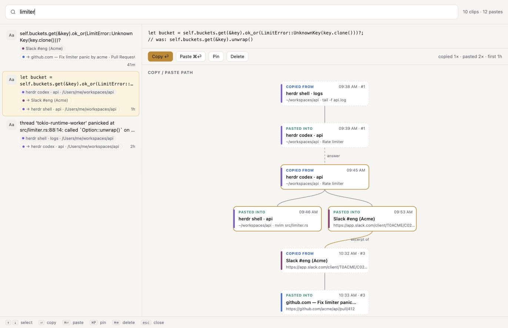
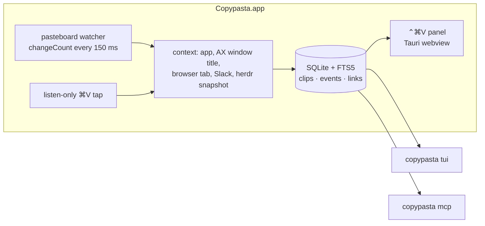

<div align="center">


# copypasta

**Clipboard history that remembers where things came from, and where they went.**

Every copy is recorded with its source window. Every ⌘V is recorded with its destination.
Click any clip to see the path it took between your browser tabs, Slack channels and [herdr](https://herdr.dev) agent panes, drawn as a graph.



</div>

---

## Why

Clipboard managers remember *what* you copied. When you work with coding agents, you also need to know *where it came from*:

- *Which pane did this stack trace come from, and which agent did I paste it into?*
- *Did that fix go to #eng before or after I put it in the PR?*
- *What screenshot did I give Claude an hour ago?*

copypasta keeps that history and draws it as a DAG.

```
┌ clip #1 text: thread 'tokio-runtime-worker' panicked at src/limiter.rs:88:14 …
• copied from herdr shell · logs · ~/workspaces/api           [09:37]
  → pasted into herdr codex · api · ~/workspaces/api          [09:38]
    ┌ clip #2 text: let bucket = self.buckets.get(&key).ok_or(LimitError::…
    → [via_context] copied from herdr codex · api              [09:44]
      → pasted into herdr shell · api  (nvim src/limiter.rs)   [09:45]
      → pasted into Slack #eng (Acme)                          [09:52]
        ┌ clip #3 text: self.buckets.get(&key).ok_or(LimitError::UnknownKey(…
        → [excerpt] copied from Slack #eng (Acme)              [10:31]
          → pasted into github.com — Fix limiter panic · PR #412 [10:32]
```

## Features

- **⌃⌘V panel.** A floating window with the search box already focused: type to filter, `↑↓` to move, `⏎` to copy, `⌘⏎` to paste into the window you came from. The shortcut mirrors Omarchy's Super+Ctrl+V.
- **Full-text search** over clip text *and* places. `slack eng`, `docs.rs`, `herdr claude` and `limiter.rs` all work, including substring matches (trigram index).
- **Rich context** for every copy and paste:
  - **Browsers:** the tab URL and title (Chrome, Brave, Edge, Arc, Safari; Firefox gets the window title only).
  - **Slack (web):** the channel or DM and the workspace.
  - **herdr:** the workspace, tab, pane, agent (claude, codex, …), agent session, cwd and pane title.
  - **Everything else:** the app and window title.
- **Lineage DAG.** Nodes are moments in a window ("copied from…", "pasted into…"); edges follow the content:
  - **pasted / re-copied:** the same clip moving between places.
  - **content links:** a new clip *quotes*, *is an excerpt of*, or *is similar to* an older one, or is the *same image* (perceptual hash).
  - **answer links:** you pasted into an agent pane or a web chat assistant, then copied something back out of it.
- **Images.** Region screenshots (⌃⇧⌘4), "Copy Image" from the browser, and image URLs, each with thumbnails.
- **herdr tab.** `copypasta tui` gives you the same search and lineage in a terminal pane.
- **MCP server.** `copypasta mcp` lets agents ask *"where did this text come from?"*
- **Private by default.** Everything stays in a local SQLite file:
  - Password-manager clips (concealed or transient pasteboard types) are ignored.
  - Anything that looks like a credential is stored only as a hash plus a masked preview.
  - History is kept for **30 days or 2 GB**, whichever limit is hit first; pinned clips are kept.

## Install (macOS)

One line, Apple Silicon:

```sh
curl -fsSL https://raw.githubusercontent.com/base698/copypasta/main/install.sh | sh
```

The installer:

- downloads the latest release and checks it against `SHA256SUMS` and its code signature;
- installs `~/Applications/Copypasta.app` and `~/.local/bin/copypasta`;
- starts the app at login.

Then press **⌃⌘V**.

> **Why not just download the zip?** Releases are currently signed with an Apple *Development* certificate, not a notarized Developer ID. macOS 15+ refuses to open such apps once a browser has quarantined them, and the old right-click → Open bypass is gone. `curl` doesn't add quarantine, which is why the installer works. Notarized builds are coming (see `scripts/release-macos.sh`). If you already downloaded the zip: `xattr -dr com.apple.quarantine ~/Applications/Copypasta.app`.

Or build from source (Rust 1.80+):

```sh
git clone https://github.com/base698/copypasta && cd copypasta
./scripts/install-macos.sh     # builds, signs with your Apple Development identity, installs a login agent
```

The script puts the app in `~/Applications/Copypasta.app` and the CLI in `~/.local/bin/copypasta`, then starts the app at login via `launchd`. The log is at `~/Library/Logs/copypasta.log`.

### Permissions

macOS will ask for three:

| Permission | Why |
| --- | --- |
| **Accessibility** | Read the focused window's title, and synthesize ⌘V for "paste" from the panel |
| **Input Monitoring** | A listen-only key tap that reacts *only* to ⌘V (and ⇧⌘V / ⌥⇧⌘V) to record paste destinations; no other keys are looked at or stored |
| **Automation** (per browser) | Ask the browser for the active tab's URL and title |

Copying is recorded without any of them; you just get less context.

## Use

| | |
| --- | --- |
| `⌃⌘V` | open or close the panel |
| type | search clips, URLs, channels, panes |
| `↑` `↓` / click | select; the right side shows the clip and its path |
| `⏎` | put the clip back on the clipboard |
| `⌘⏎` | …and paste it into the previous window |
| `⌘P` / `⌘⌫` | pin / delete |
| click a dashed node | jump to that related clip |

### In herdr

```sh
herdr tab create --label clips   # then, in the new pane:
copypasta tui
```

Type to search, `↑↓` to select, `⏎` to copy, `^D`/`^E` to scroll the lineage, `esc` to clear or quit.

### For agents (MCP)

```sh
claude mcp add -s user copypasta -- ~/.local/bin/copypasta mcp
```

| Tool | |
| --- | --- |
| `clipboard_trace` | `{text}` or `{clip_id}` → where it was copied from, where it was pasted, and related clips |
| `clipboard_search` | `{query, limit}` → matching clips with sources and destinations |

### CLI

```sh
copypasta search slack eng        # recent clips matching every term
copypasta trace "ok_or(LimitError"
pbpaste | copypasta trace -       # where did what's on my clipboard come from?
copypasta stats | gc | demo       # demo seeds a sample history into $COPYPASTA_HOME
```

## How it works



- **Clips** are content-addressed: the SHA-256 of the text, or of the PNG for images.
- **Events** are copies and pastes, each with a JSON context and a stable *place key*, e.g. `herdr:w1:p4`, `slack:Acme/C02ENG` or `web:https://…`.
- **Links** always point from an older clip to a newer one, so the graph is acyclic by construction. *Content links* compare a new clip with recent ones: containment, word 3-gram Jaccard ≥ 0.5, or image dHash distance ≤ 5. *Answer links* connect the last paste into an assistant with a copy out of that same place within 30 minutes.
- **herdr context** comes from `herdr api snapshot`, which takes about 8 ms, whenever a terminal is frontmost and a herdr client is attached.

```
crates/
  copypasta-core   storage, search, lineage, graph, macOS pasteboard
  copypasta-app    Tauri panel + capture daemon (pasteboard poll, key tap, AX, AppleScript)
  copypasta-cli    `copypasta` — tui, mcp, search, trace
```

## Roadmap

- **Linux / Omarchy (Hyprland).** Watch the clipboard with `wl-paste --watch`, get the window from `hyprctl activewindow`, and wrap Omarchy's Super+V binding to log pastes, so no key tap is needed. Optionally, an [Elephant](https://github.com/abenz1267/elephant) provider so the history also shows up in Walker.
- Notarized Developer ID builds (`scripts/release-macos.sh` is ready; needs the certificate).
- Menu-paste detection on macOS (lazy pasteboard providers).

## License

MIT
