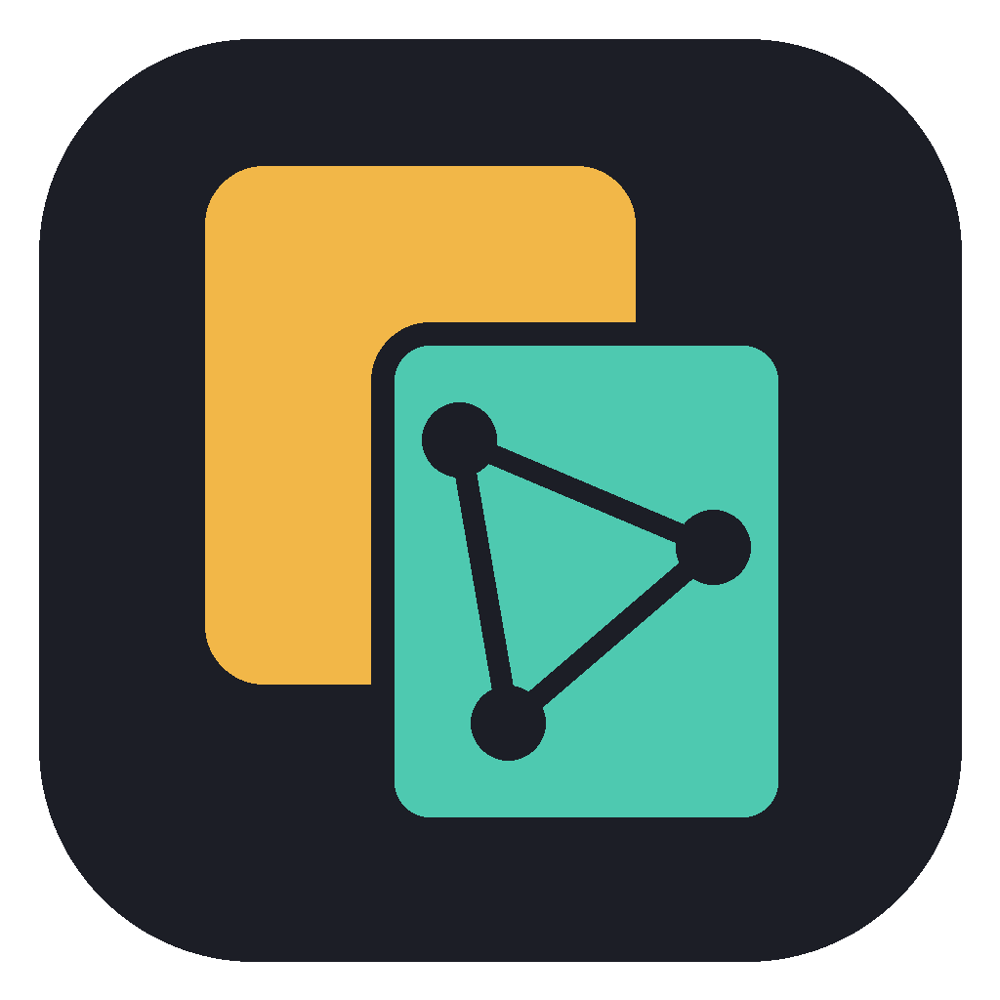
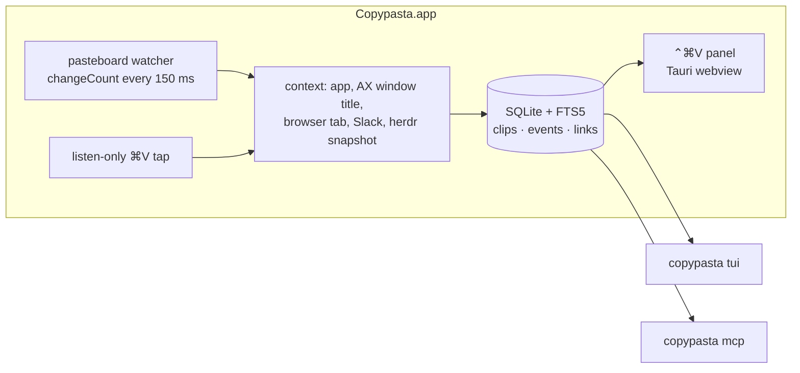

<div align="center">



# copypasta

**Clipboard history that remembers where things came from, and where they went.**

Every copy is recorded with its source window. Every ⌘V is recorded with its destination.
Click any clip to see the path it took between your browser tabs, Slack channels and [herdr](https://herdr.dev) agent panes, drawn as a graph.


</div>

---

## Why

Clipboard managers remember *what* you copied. When you work with coding agents, you also need to know *where it came from*:

- *Which pane did this stack trace come from, and which agent did I paste it into?*
- *Did that fix go to #eng before or after I put it in the PR?*
- *What screenshot did I give Claude an hour ago?*

copypasta keeps that history and draws it as a DAG.

```
┌ clip #1 text: thread 'tokio-runtime-worker' panicked at src/limiter.rs:88:14 …
• copied from herdr shell · logs · ~/workspaces/api           [09:37]
  → pasted into herdr codex · api · ~/workspaces/api          [09:38]
    ┌ clip #2 text: let bucket = self.buckets.get(&key).ok_or(LimitError::…
    → [via_context] copied from herdr codex · api              [09:44]
      → pasted into herdr shell · api  (nvim src/limiter.rs)   [09:45]
      → pasted into Slack #eng (Acme)                          [09:52]
        ┌ clip #3 text: self.buckets.get(&key).ok_or(LimitError::UnknownKey(…
        → [excerpt] copied from Slack #eng (Acme)              [10:31]
          → pasted into github.com — Fix limiter panic · PR #412 [10:32]
```

## Features

- **⌃⌘V panel.** A floating window with the search box already focused: type to filter, `↑↓` to move, `⏎` to copy, `⌘⏎` to paste into the window you came from. The shortcut mirrors Omarchy's Super+Ctrl+V.
- **Groups per herdr workspace.** Clips collapse under the workspace they were first copied in. Clips copied outside herdr join the first workspace you paste them into. Make your own groups, rename any group, and drag clips between them. [More below.](#groups)
- **Full-text search** over clip text *and* places. `slack eng`, `docs.rs`, `herdr claude` and `limiter.rs` all work, including substring matches (trigram index).
- **Rich context** for every copy and paste:
  - **Browsers:** the tab URL and title (Chrome, Brave, Edge, Arc, Safari; Firefox gets the window title only).
  - **Slack (web):** the channel or DM and the workspace.
  - **herdr:** the workspace, tab, pane, agent (claude, codex, …), agent session, cwd and pane title. This covers herdr in a terminal and the Herdr app, whose spaces count as workspaces.
  - **Everything else:** the app and window title.
- **Lineage.** The clip and every clip related to it, oldest first. Each card lists where that clip was copied from and pasted into (repeats in one place shown as ×N), and says how it relates to an earlier clip:
  - *includes #5* or *is part of #5*: one contains the other's text.
  - *is an edited version of #5*: near-identical text (also marked `edit of #5` in the list).
  - *is the same image as #5*: perceptual hash match.
  - *was copied out of claude after #5 was pasted there*: you pasted into an agent pane or a web chat assistant, then copied its answer.
- **Images.** Screenshots, "Copy Image" from the browser, and image URLs, each with thumbnails. Screenshots count whether you copy them (⌃⇧⌘4) or save them (⇧⌘4): saved ones are picked up from your screenshot folder and listed at the time you took them, among your other clips. `⇧⌘⏎` pastes an image's file path instead of the image, which is what an agent in a terminal wants.
- **Downloads.** Files that arrive in your Downloads folder are listed when they arrive, among your other clips: images up to 8 MB with their picture, everything else by its path alone. `⇧⌘⏎` pastes the path.
- **herdr tab.** `copypasta tui` gives you the same search and lineage in a terminal pane.
- **MCP server.** `copypasta mcp` lets agents ask *"where did this text come from?"*
- **Private by default.** Everything stays in a local SQLite file:
  - Password-manager clips are ignored: concealed or transient pasteboard types, and anything copied from Bitwarden, 1Password, KeePassXC, Apple Passwords and similar apps.
  - Anything that looks like a credential (API keys, tokens, or a lone generated-password-like string) is stored only as a hash plus a masked preview.
  - History is kept for **30 days or 2 GB**, whichever limit is hit first; pinned clips are kept.

## Install (macOS)

One line, Apple Silicon:

```sh
curl -fsSL https://raw.githubusercontent.com/base698/copypasta/main/install.sh | sh
```

The installer:

- downloads the latest release and checks it against `SHA256SUMS` and its code signature;
- installs `~/Applications/Copypasta.app` and `~/.local/bin/copypasta`;
- starts the app at login.

Then press **⌃⌘V**.

> **Why not just download the zip?** Releases are currently signed with an Apple *Development* certificate, not a notarized Developer ID. macOS 15+ refuses to open such apps once a browser has quarantined them, and the old right-click → Open bypass is gone. `curl` doesn't add quarantine, which is why the installer works. Notarized builds are coming (see `scripts/release-macos.sh`). If you already downloaded the zip: `xattr -dr com.apple.quarantine ~/Applications/Copypasta.app`.

Or build from source (Rust 1.80+):

```sh
git clone https://github.com/base698/copypasta && cd copypasta
./scripts/install-macos.sh     # builds, signs with your Apple Development identity, installs a login agent
```

The script puts the app in `~/Applications/Copypasta.app` and the CLI in `~/.local/bin/copypasta`, then starts the app at login via `launchd`. The log is at `~/Library/Logs/copypasta.log`.

### Permissions

macOS will ask for up to four:

| Permission | Why |
| --- | --- |
| **Accessibility** | Read the focused window's title, and synthesize ⌘V for "paste" from the panel |
| **Input Monitoring** | A listen-only key tap that reacts *only* to ⌘V (and ⇧⌘V / ⌥⇧⌘V) to record paste destinations; no other keys are looked at or stored |
| **Automation** (per browser) | Ask the browser for the active tab's URL and title |
| **Files and Folders** (Downloads; Desktop or Documents) | List the files you download and read the screenshots you save. Desktop or Documents is only asked for if that is where macOS saves screenshots, and only files macOS marked as screenshots are read there |

Copying is recorded without any of them; you just get less context.

## Use

| | |
| --- | --- |
| `⌃⌘V` | open or close the panel |
| type | search clips, URLs, channels, panes |
| `↑` `↓` / click | select; the right side shows the clip and its path |
| `⏎` | put the clip back on the clipboard |
| `⌘⏎` | …and paste it into the previous window |
| `⇧⌘⏎` | paste the clip's file path instead: the screenshot file, a stored copy for other images, the paths of copied files. Quoted the way a dropped file is when the previous window is a terminal |
| `←` `→` | collapse / expand a group (or jump from a clip to its group) |
| `⌘G` | move the selected clip to another group |
| `⌘P` / `⌘⌫` | pin / delete |
| click a dashed node | jump to that related clip |

### Groups

Every herdr workspace gets a group automatically, keyed by the workspace name. The list shows collapsible groups, most recently active first, loading 40 clips at a time as you scroll.

| Situation | Where the clip goes |
| --- | --- |
| Copied in a herdr pane | That pane's workspace group |
| Copied in a browser, Slack, … | **Ungrouped**, until it's first pasted into a herdr workspace; then it joins that workspace |
| Copied in workspace **A**, pasted into workspace **B** | Stays in **A**. It's also listed in **B** as *incoming* (`⇢ from A`), and **B**'s header counts it (`+1 in`). The DAG shows it crossing over. |
| Copied out of **B** after that paste (e.g. Claude's answer) | **B**, linked back to the clip from **A** in the lineage |
| You moved it (menu, ⌘G, or drag onto a group header) | Wherever you put it. Automatic grouping never overrides a manual choice; pick *Automatic* in the menu to go back. |

Select a group header to rename or delete it. Deleting a group keeps its clips, which become ungrouped. To filter by group, search `g:<name>`; `g:none` shows only ungrouped clips.

### In herdr

```sh
herdr tab create --label clips   # then, in the new pane:
copypasta tui
```

Type to search (`g:name` works here too), `tab`/`shift-tab` to cycle groups, `↑↓` to select (more clips load as you go), `⏎` to copy, `^D`/`^E` to scroll the lineage, `esc` to clear or quit.

`copypasta panel` opens or closes the app's panel, exactly as ⌃⌘V does. Bind it to a key in herdr (or anything else that runs commands) if you would rather open the panel from there.

### For agents (MCP)

```sh
claude mcp add -s user copypasta -- ~/.local/bin/copypasta mcp
```

| Tool | |
| --- | --- |
| `clipboard_trace` | `{text}` or `{clip_id}` → where it was copied from, where it was pasted, and related clips |
| `clipboard_search` | `{query, limit, offset}` → matching clips with group, sources and destinations (`g:name` filters) |
| `clipboard_groups` | `{query}` → groups (herdr workspaces and your own) with counts and incoming pastes |

### CLI

```sh
copypasta search slack eng        # recent clips matching every term
copypasta groups                  # groups with clip and incoming counts
copypasta search g:api limiter    # within one group
copypasta trace "ok_or(LimitError"
pbpaste | copypasta trace -       # where did what's on my clipboard come from?
copypasta stats | gc | demo       # demo seeds a sample history into $COPYPASTA_HOME
copypasta api groups '{"query":""}'   # the panel's JSON API (search, groups, move, rename_group, …)
```

## How it works



- **Clips** are content-addressed: the SHA-256 of the text, or of the PNG for images.
- **Events** are copies and pastes, each with a JSON context, a stable *place key* (e.g. `herdr:w1:p4`, `slack:Acme/C02ENG` or `web:https://…`) and the herdr workspace, if any.
- **Groups**: a clip gets one group, automatic or manual. "Incoming" isn't stored; it's computed from paste events into a workspace.
- **Upgrades**: schema changes run as numbered migrations, and 0.1 databases are upgraded and regrouped on first launch.
- **Links** always point from an older clip to a newer one, so the graph is acyclic by construction. *Content links* compare a new clip with recent ones: containment, word 3-gram Jaccard ≥ 0.5, or image dHash distance ≤ 5. *Answer links* connect the last paste into an assistant with a copy out of that same place within 30 minutes.
- **herdr context** comes from `herdr api snapshot`, which takes about 8 ms, whenever a terminal is frontmost and a herdr client is attached. When the Herdr app is frontmost it comes from the app's own `status` and `ls` plus `hc get` for the terminal's folder, about 10 ms each.

```
crates/
  copypasta-core   storage, search, groups, lineage, graph, JSON api, macOS pasteboard
  copypasta-app    Tauri panel + capture daemon (pasteboard poll, key tap, AX, AppleScript)
  copypasta-cli    `copypasta` — tui, mcp, search, trace
```

## Roadmap

- **Linux / Omarchy (Hyprland).** Watch the clipboard with `wl-paste --watch`, get the window from `hyprctl activewindow`, and wrap Omarchy's Super+V binding to log pastes, so no key tap is needed. Optionally, an [Elephant](https://github.com/abenz1267/elephant) provider so the history also shows up in Walker.
- Notarized Developer ID builds (`scripts/release-macos.sh` is ready; needs the certificate).
- Menu-paste detection on macOS (lazy pasteboard providers).

## License

MIT
